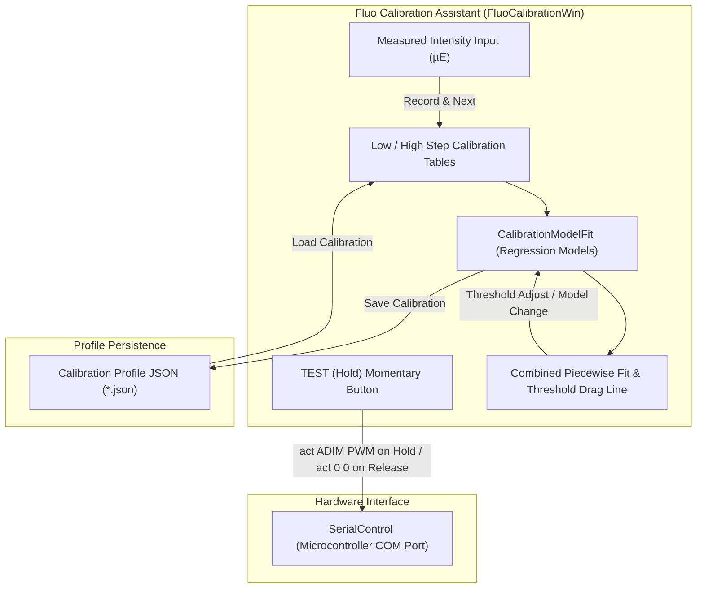

# Fluo Calibration Assistant Module (Polymager)

The **Fluo Calibration Assistant** ([FluoCalibrationWin](file:///c:/Users/gerva/OneDrive/Documents/GitHub/Pipeline_creator_dev/modules/Polymager/Fluo_controller/fluo_calibration_win.py)) is an interactive dialog companion to the [Fluo Controller](file:///c:/Users/gerva/OneDrive/Documents/GitHub/Pipeline_creator_dev/modules/Polymager/Fluo_controller/fluo_controller_win.py). It guides the user through measuring and modeling the Actinic LED illumination output across its full dynamic range using physical quantum sensor readings (µmol photons·m⁻²·s⁻¹ / µE).

---

## Two-Regime Calibration Architecture

To achieve high precision at low illumination levels without sacrificing maximum saturating output, the hardware uses a dual-regime approach:

1. **Low Regime ($\le$ Threshold)**: PWM duty cycle is varied (typically 5 to 75) while analogue dimming is held constant at maximum (`ADIM = 512`). Best modeled via **Power Law** ($I = a \cdot X^b$) or Polynomial regression.
2. **High Regime ($>$ Threshold)**: Analogue dimming (`ADIM`, typically 10 to 512) is varied while PWM is held constant at full duty cycle (`PWM = 512`). Best modeled via **Linear** ($I = a \cdot X + b$) or Polynomial regression.



---

## Key Features

- **Momentary Safety Testing**: The `TEST (Hold)` button only illuminates the Actinic LED while actively pressed down; releasing the mouse immediately extinguishes the LED (`act 0 0`) to prevent sensor saturation or thermal overload.
- **Guided Step Recording**: The `Record & Next` workflow steps sequentially through pre-configured PWM and ADIM levels, prompting the user for external sensor readouts.
- **Configurable Regression Models**:
  - **Linear** ($I = a \cdot X + b$)
  - **Polynomial** (Degree 2 through 5)
  - **Power Law** ($I = a \cdot X^b$)
- **Live Goodness-of-Fit (R²)**: Computes coefficient of determination in real time to validate model fidelity.
- **Interactive Threshold Drag Line**: A draggable threshold line on the combined plot updates the crossover intensity separating low and high regimes on the fly.
- **Profile Portability**: Full JSON serialization of step points, measured intensities, regression parameters, and threshold settings.

---

## Technical Specifications

### Regression Models (`CalibrationModelFit`)

| Model Type | Formula | Inversion Behavior | Typical Use Case |
|---|---|---|---|
| `power` | $I = a \cdot X^b$ | Analytical power root | Low-regime PWM (fine sub-threshold dimming) |
| `linear` | $I = a \cdot X + b$ | Analytical linear inverse | High-regime ADIM (analogue current control) |
| `polynomial` | $I = \sum_{k=0}^{n} c_k X^k$ | Monotonic grid interpolation | Non-linear driver responses (degrees 2–5) |

### JSON Profile Structure

```json
{
  "threshold": 150,
  "low_cal": {
    "pwm": [5, 10, 15, 20, 25, 30, 35, 40, 45, 50, 55, 60, 65, 70, 75],
    "intensity": [1.2, 3.5, 7.8, 14.1, 22.0, 31.5, 42.1, 54.0, 67.2, 81.5, 96.8, 112.5, 128.0, 142.1, 150.0],
    "model_type": "power",
    "popt": [0.0821, 1.745]
  },
  "high_cal": {
    "adim": [10, 20, 30, 40, 50, 100, 200, 300, 400, 500, 512],
    "intensity": [155.0, 210.0, 280.0, 360.0, 440.0, 850.0, 1680.0, 2490.0, 3280.0, 4080.0, 4175.0],
    "model_type": "linear",
    "popt": [8.051, 85.2]
  }
}
```

---

## UI Layout

1. **Header**:
   - Title display and numeric **Threshold (µE)** input.
   - Active setting readout (current PWM and ADIM levels).
2. **Measurement Action Row**:
   - `TEST (Hold)` button with real-time status text.
   - `Measured (µE)` input field and `Record & Next` advancement button.
3. **Tabs**:
   - **Low Mode (PWM)**: Step list table, measured values, and direct row selection.
   - **High Mode (ADIM)**: High-intensity step table and measured values.
   - **Curves & Models**: Side-by-side plots of Low Regime, High Regime, and Combined Piecewise curves with regression selection combo boxes and degree spinners.
4. **Footer**:
   - Save, Load, and Reset to Factory Defaults actions.

---

## Lifecycle Methods

- **`show()`**: Focuses or recreates the calibration window.
- **`is_ready()`**: Returns `True`.
- **`on_close()`**: Extinguishes light burst and hides window.
- **`close()` / `destroy()`**: Ensures light is turned off, deletes DearPyGui item handlers and window tags, and releases resources.
