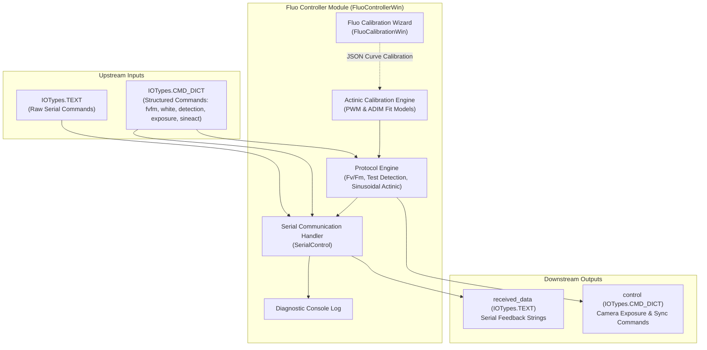

# Fluo Controller Module (Polymager)

The **Fluo Controller** module provides low-level and automated serial communication with the fluorescence illumination hardware. It orchestrates multi-channel LED sources (Actinic, Detection, Far-Red, and dual White channels), supports calibration-aware µE intensity scaling, and drives standardized photosynthetic protocols (Fv/Fm saturation pulses, test detection pulses, and fixed/variable illumination sweeps).

---

## Architecture & Data Flow

---

## Key Features

- **Multi-Channel LED Management**: Real-time control of Actinic (dual-regime ADIM / PWM), Detection, Far-Red, and White channels.
- **Calibrated Actinic Output (µE)**: Two-regime piecewise fitting mapping hardware commands (0–512) directly to photosynthetic photon flux density (µmol photons·m⁻²·s⁻¹ / µE).
- **Automated Fv/Fm Sequences**: Triggers calibrated saturating pulses and detection flashes for chlorophyll fluorescence transient measurements.
- **Exposure Synchronization**: Emits synchronized camera exposure updates (`IOTypes.CMD_DICT`) whenever detection pulse durations change.
- **Sinusoidal Actinic Modulation**: Sends continuous sine wave amplitude and frequency sweeps for dynamic photosynthesis experiments.
- **Integrated Calibration Assistant**: Embedded dialog ([FluoCalibrationWin](file:///c:/Users/gerva/OneDrive/Documents/GitHub/Pipeline_creator_dev/modules/Polymager/Fluo_controller/fluo_calibration_win.py)) with step-by-step recording, momentary test bursts, and regression modeling.
- **Role-Based UI Permissions**: In `user` mode, administrative calibration tools and advanced manual LED controls are hidden, exposing only connection controls, calibration file browsing, and test detection.

---

## Technical Specifications

### Inputs

| Input Type | Description |
|---|---|
| `IOTypes.TEXT` | Raw serial ASCII command string forwarded directly to the connected controller. |
| `IOTypes.CMD_DICT` | Structured command dictionary supporting `fvfm`, `detection`, `exposure`, `testdet`, `white`, `white2`, `det`, `fluo_fixed_int_test`, and `sineact`. |

### Outputs

| Output Name | Type | Description |
|---|---|---|
| `received_data` | `IOTypes.TEXT` | Emits incoming serial response messages received from the microcontroller. |
| `control` | `IOTypes.CMD_DICT` | Dispatches synchronized camera control parameters (such as `{"exposure": dur}`). |

### Persistent Fields

| Field | Type | Default | Description |
|---|---|---|---|
| `label` | `str` | `"Fluo Controller"` | Display label of the window instance. |

---

## UI Controls

- **Connection Bar**:
  - **Refresh** (Button): Scans available serial COM ports.
  - **Port Selector** (Combo): Selects target communication port.
  - **Connect / Disconnect** (Button): Opens or terminates serial connection (color-coded status).
- **Calibration Bar**:
  - **Browse** (Button): Loads an existing calibration JSON file.
  - **Calibrate** (Button): Launches the interactive Actinic Calibration Assistant.
  - **Filename Label** (Text): Displays the active calibration profile filename.
- **Test Detection**:
  - **Dur** (Drag Int): Detection pulse duration in microseconds (syncs to `app_state.detector`).
  - **Dim** (Drag Int): Detection LED brightness (0–512, syncs to `app_state.ddim`).
  - **Start** (Button): Fires a single detection pulse.
- **Advanced Controls (Hidden in User Mode)**:
  - **Act & PWM** (Drag Ints): Manual Actinic amplitude (ADIM) and PWM duty cycle.
  - **µE** (Drag Int): Target actinic intensity in physical units (visible when calibration is loaded).
  - **Det / Fr / Wh / Wh2** (Drag Ints): Detection, Far-Red, and White LED output levels.
  - **Fv/Fm Test**: Configurable pulse duration, detection delay, and intensity with one-click trigger.
  - **Fixed Int / Fixed Exp Sweeps**: Variable exposure or intensity protocol sweeps.
  - **Sin Control**: Configures and drives sinusoidal actinic light modulation.
  - **Console Log**: Scrollable read-only multiline terminal displaying serial exchanges.

---

## Lifecycle & Base Class Conformance

- **`is_ready()`**: Returns readiness state (`not self._is_closing`).
- **`update_permission()`**: Hides calibration actions and manual slider arrays in `user` mode while locking window close button.
- **`on_close()`**: Stops background read thread, disconnects serial port, releases `calib_dialog`, and calls `super().on_close()`.
- **`close()`**: Performs full unregistration and destroys the window.
- **`destroy()`**: Releases all hardware and UI resources.
