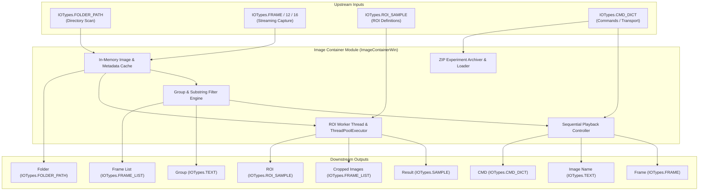

# Image Container Module (Polymager)

The **Image Container** module manages, caches, filters, and replays experimental image sequences in memory. It provides core sequence caching for the Polymager pipeline with multi-ROI batch analysis, experiment persistence (ZIP import/export), and synchronous sequence distribution to downstream viewers and processors.

---

## Architecture & Data Flow

---

## Key Features

- **In-Memory Sequence Caching**: Loads image files from disk or collects streaming frames in memory with metadata extraction (ID, Group, Timestamp, Intensity).
- **Group & Filename Filtering**: Real-time filtering of image sequences by biological group tag and alphanumeric substrings.
- **Asynchronous ROI Batch Analysis**: Dedicated background worker computing mean intensities across full sequences for rect-based or mask-based ROIs without UI stutter.
- **Experiment Persistence (ZIP Export/Import)**: Serializes full image caches and associated metadata dictionaries into compressed archives for archiving and sharing.
- **Interactive Sequence Playback**: Transport controls (Play, Stop, adjustable FPS) streaming selected frames downstream.
- **High-DPI Display Scaling**: Uses `display_scaling.scale(...)` to maintain proportional layout across diverse monitors.
- **X-Axis Modes**: Supports dynamic X-axis coordinate resolution (`Index`, `Time`, or `Intensity`).

---

## Technical Specifications

### Inputs

| Input Type | Description |
|---|---|
| `IOTypes.FOLDER_PATH` | Directory path string to scan and load images into memory cache. |
| `IOTypes.FRAME` / `IOTypes.FRAME12` / `IOTypes.FRAME16` | Incoming image frame array (appends to cache). |
| `IOTypes.ROI_SAMPLE` | ROI sample descriptor triggering batch mean intensity calculation across the loaded sequence. |
| `IOTypes.CMD_DICT` | Command dictionary supporting: `{"browse": True}`, `{"record": bool}`, `{"save": bool}`, `{"add_timestamp": bool}`, `{"reset_ts": True}`, `{"manual": bool}`, `{"load": str}`. |

### Outputs

| Output Name | Type | Description |
|---|---|---|
| `Frame` | `IOTypes.FRAME` | Emits currently selected or replayed image frame. |
| `Result` | `IOTypes.SAMPLE` | Emits ROI sample analysis curves and time series points. |
| `Folder` | `IOTypes.FOLDER_PATH` | Emits active folder path upon selection. |
| `Group` | `IOTypes.TEXT` | Emits currently selected group name. |
| `CMD` | `IOTypes.CMD_DICT` | Dispatches control commands to downstream modules (e.g. position updates). |
| `ROI` | `IOTypes.ROI_SAMPLE` | Emits ROI sample descriptors. |
| `Image Name` | `IOTypes.TEXT` | Emits filename of currently displayed image. |
| `Cropped Images` | `IOTypes.FRAME_LIST` | Emits cropped sub-images based on active ROIs. |
| `Frame List` | `IOTypes.FRAME_LIST` | Emits list of all filtered cached frames upon request. |

### Persistent Fields

| Field | Type | Default | Description |
|---|---|---|---|
| `label` | `str` | `"Image Container"` | Display label of the window instance. |
| `folder_path` | `str` | `""` (falls back to `<root>/experiments`) | Root directory path for image loading and sequence scanning. |

---

## UI Controls

- **Browse** (Button): Opens native OS folder picker to load an image directory.
- **Export** (Button): Exports active experiment images and metadata to a ZIP archive.
- **Import** (Button): Imports a previously saved experiment archive.
- **Group** (Combo): Filters loaded images by group tag.
- **Filter** (Input Text): Filters filenames by substring.
- **Play / Stop** (Buttons): Controls sequence playback with FontAwesome transport icons.
- **FPS** (Drag Int): Configures playback rate (1 to 60 FPS).
- **Record / Save / Timestamp** (Checkboxes): Toggles automatic recording and timestamp metadata tracking.
- **X-Axis** (Combo): Selects X-coordinate calculation mode (`Index`, `Time`, `Intensity`).
- **Send** (Button): Dispatches full filtered frame list to connected consumers.
- **Clear List** (Button): Empties memory cache and resets ROI tracking.
- **Image Listbox**: Scrollable list of cached images for manual selection and preview.

---

## Lifecycle & Base Class Conformance

- **`is_ready()`**: Returns readiness state (`not self._is_closing`).
- **`update_permission()`**: Disables administrative and editing controls in user mode (`app_state.mode == "user"`), while locking the window close button (`no_close=True`).
- **`on_close()`**: Halts playback thread, stops ROI background worker, signals background queues, and invokes `super().on_close()`. Guarded by `_is_closing`.
- **`close()`**: Cleans up progress modals and handler registries, closes window, and unregisters the module.
- **`destroy()`**: Releases all resources and destroys the window.
