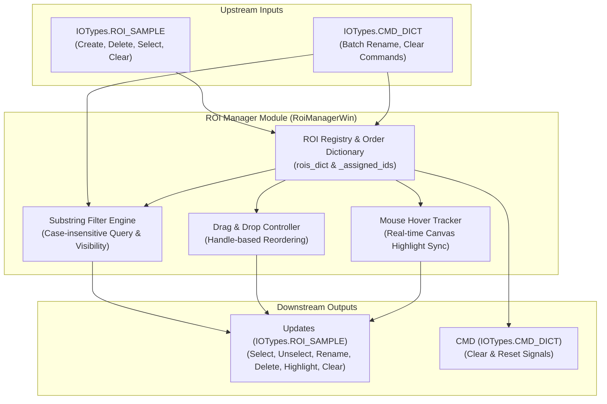

# ROI Manager Module (Polymager)

The **ROI Manager** module provides centralized management, naming, filtering, ordering, and selection of Regions of Interest (ROIs) across Polymager image analysis pipelines. It bi-directionally synchronizes with upstream image viewers (which draw bounding boxes, polygons, or masks) and downstream processing engines (e.g., Image Container) that calculate batch intensity kinetics across active ROIs.

---

## Architecture & Data Flow

---

## Key Features

- **Bi-Directional ROI Synchronization**:
  - Automatically captures newly created ROIs from connected Image Viewers (`create` action).
  - Propagates selection status (`select`, `unselect`), custom names (`rename`), and deletion (`delete`) downstream in real time.
  - Implements circular `visited` tracking to eliminate infinite signal loops in interconnected pipelines.

- **Dynamic Real-Time Substring Filtering**:
  - Instantaneous case-insensitive name filtering via search input.
  - Non-matching ROIs are visually hidden and automatically deselected, preventing unintended inclusion in batch measurements.
  - Dedicated one-click "X" button to quickly reset filtering.

- **Interactive Drag & Drop Reordering**:
  - Each ROI row includes a dedicated drag handle (`\uf0c9`) styled with hover highlights.
  - Dragging a handle and dropping onto another row cleanly reorders the internal sequence (`rois_dict`) and rebuilds the UI while preserving checkboxes and text inputs.

- **Canvas Hover Highlighting**:
  - Tracking mouse movement highlights the active ROI boundary in the connected Image Viewer whenever the cursor hovers over the corresponding checkbox, name field, or drag handle.
  - Automatically dispatches `unhighlight` when the cursor leaves the row or window.

- **Numeric ID Tracking & Recycling**:
  - Maintains `_assigned_ids` to track sequentially numbered ROIs, allowing freed numeric IDs to be reused by upstream generators.

- **High-DPI Display Scaling & Modern Architecture**:
  - Uses `display_scaling.scale(...)` across all layout buttons, text fields, spacers, and theme styles.
  - Strict lifecycle management (`WindowBase` conformance) cleaning up handler registries and theme components upon destruction.

---

## Technical Specifications

### Inputs

| Input Type | Description |
|---|---|
| `IOTypes.ROI_SAMPLE` | Sample payload dictionary containing ROI attributes (`uuid`, `name`, `action`, `selected`, `coordinates`). Supported actions include: `create`, `delete`, `select`, `unselect`, and `clear`. |
| `IOTypes.CMD_DICT` | Command dictionary supporting: `{"clear": True}`, `{"action": "clear"}`, and `{"rename": [name1, name2, ...]}` for batch sequential renaming. |

### Outputs

| Output Name | Type | Description |
|---|---|---|
| `Updates` | `IOTypes.ROI_SAMPLE` | Emits updated ROI sample descriptors to connected modules with action flags (`create`, `delete`, `select`, `unselect`, `rename`, `highlight`, `unhighlight`, `clear`). |
| `CMD` | `IOTypes.CMD_DICT` | Dispatches reset and clear signals downstream (`{"clear": True, "reset_counter": True}`). |

---

## Persistent Fields

| Field Name | Type | Default | Description |
|---|---|---|---|
| `label` | `str` | `"ROI Manager"` | Display title of the module window. |
| `silent_clear_on_cmd` | `bool` | `False` | When True, clears ROIs locally without dispatching outward clear events to avoid duplicate broadcast storms. |
| `filter_text` | `str` | `""` | Active substring filter query string preserved across sessions. |

---

## User Interface & Control Layout

1. **Top Control Bar**:
   - **Clear ROIs**: Deletes all active ROIs locally and broadcasts clear signals to connected viewers.
   - **Select All**: Selects all currently visible ROIs matching the active filter.
   - **Deselect All**: Deselects all active ROIs.

2. **Filter Bar**:
   - **Filter Text Field**: Substring input for case-insensitive matching.
   - **Clear "X" Button**: Resets the filter text field and restores full list visibility.

3. **ROI List Container**:
   - Dynamically populated scrollable list of ROI rows. Each row contains:
     - **Drag Handle (`\uf0c9`)**: Drag-and-drop anchor for reordering.
     - **Selection Checkbox**: Toggles whether the ROI is included in downstream kinetics and batch exports.
     - **Name Input Field**: Editable label allowing custom specimen or condition naming.
     - **Delete Button (`\uf2ed`)**: Destroys the individual ROI and removes its overlay from connected viewers.

---

## Lifecycle & Memory Management

- **Handler Registry Cleanup**: The global mouse movement handler (`_handler_registry_tag`) is registered with an explicit tag and safely deleted upon module closure.
- **Theme Teardown**: Dynamic button themes (`_handle_theme`) are cleanly unlinked and deleted in `close()`.
- **Highlight Reset**: Any active canvas highlight state is cleared before teardown to avoid lingering visual artifacts in connected viewers.
