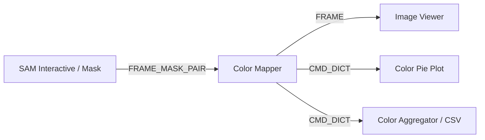

# Color Mapper Module (`color_mapper_win.py`)

## Description
Le module **Color Mapper** effectue la classification et la quantification des couleurs des pixels d'une image (sur la totalité de la trame ou à l'intérieur d'un masque de segmentation) par rapport à une palette de référence personnalisable.
Il intègre un visualiseur interactif, un outil de sonde ROI avec calcul du centroïde moyen RGB et de la classe la plus proche, un assistant de calibration interactif (wizard) et un pipeline d'exportation vers le Color Aggregator ou les modules de visualisation statistique.

---

## Entrées / Sorties

### Entrées (Inputs)
- **`IOTypes.FRAME`** : Trame vidéo brute (BGR ou RGB).
- **`IOTypes.FRAME_MASK_PAIR`** : Paire synchronisée constituée d'une image et de son masque binaire (ex: issu de SAM ou d'un seuillage).
- **`IOTypes.FOLDER_PATH`** : Répertoire cible pour la sauvegarde des images rognées détourées.
- **`IOTypes.CMD_DICT` / `IOTypes.TEXT`** : Commandes de nommage d'échantillon (`full_name`) et réinitialisation de pipeline (`clear`).

### Sorties (Outputs)
- **`Mapped Frame`** (`IOTypes.FRAME`) : Image quantifiée et colorisée avec les couleurs de la palette.
- **`Distribution`** (`IOTypes.CMD_DICT`) : Répartition statistique des surfaces/pourcentages pour chaque classe de couleur (compatible avec le module *Color Pie Plot*).
- **`CMD`** (`IOTypes.CMD_DICT`) : Commandes de réinitialisation émises vers les modules amont (ex: reset des points dans SAM).

---

## Paramètres et Configuration

| Paramètre | Type | Valeur par défaut | Description |
| :--- | :--- | :--- | :--- |
| **`roi_w`** | `int` | `20` | Largeur de la fenêtre ROI d'inspection en pixels. |
| **`roi_h`** | `int` | `20` | Hauteur de la fenêtre ROI d'inspection en pixels. |

---

## Fonctionnalités Clés

1. **Éditeur de Palette & Assistant de Calibration (Wizard)** :
   - Ajout, renommage et suppression de classes de couleurs.
   - Pastilles interactives ouvrant un sélecteur de couleur RGB pour affiner les centroïdes manuellement.
   - **Assistant Calibration** : invite l'utilisateur à faire `CTRL + Clic` directement sur les zones d'intérêt de l'image pour calibrer chaque classe de la palette successivement.
   - Sauvegarde sur disque (`palette.json`) protégée par dialogue de confirmation modal.

2. **Sonde ROI en Temps Réel** :
   - Rectangle d'inspection dynamique suivant le curseur souris affichant la couleur moyenne RGB et la classe la plus proche.
   - Modes de remplissage configurables : `No Fill`, `Mean RGB`, `Closest Color` avec gestion de l'opacité alpha.
   - Option **`RT Out`** : diffuse en temps réel la distribution de couleur du ROI sous le curseur vers les graphiques connectés.

3. **Exportation & Découpe d'Échantillons** :
   - Découpe automatique selon la boîte englobante minimale du masque.
   - Génération de deux fichiers PNG au format BGRA transparent (`_RAW.png` et `_processed.png`) enregistrés dans le dossier spécifié.
   - Envoi de la ligne de distribution vers le *Color Aggregator* avec l'identifiant d'échantillon fourni.

4. **Mode Comparaison Rapide** :
   - Bouton de maintien `Compare` basculant temporairement l'affichage sur la trame originale masquée pour validation visuelle.

---

## Exemple d'Intégration Pipeline

