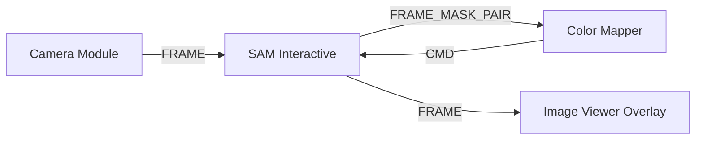

# SAM Interactive Module (`sam_interactive_win.py`)

## Description
Le module **SAM Interactive** encapsule le modèle d'IA **Segment Anything (SAM)** de Meta avec une interface interactive DearPyGui basée sur des invites par points (point prompting).
Il permet de segmenter n'importe quel objet ou région d'intérêt dans un flux vidéo en temps réel à l'aide de clics positifs (premier plan) et négatifs (arrière-plan), et de transmettre les masques de segmentation précis vers les modules d'analyse en aval.

---

## Entrées / Sorties

### Entrées (Inputs)
- **`IOTypes.FRAME` / `IOTypes.FRAME12` / `IOTypes.FRAME16`** : Flux vidéo d'entrée (images couleur 8-bit BGR/RGB, niveaux de gris ou monochromes 12/16-bit, ou tuple `(np.ndarray, str)`).
- **`IOTypes.CMD_DICT`** : Commandes de contrôle à distance :
  - `{"clear": True}` ou `{"reset_points": True}` : Réinitialise instantanément les points et le masque.
  - `{"enable": bool}` : Active ou suspend le traitement SAM pour préserver la charge processeur.

### Sorties (Outputs)
- **`Overlay`** (`IOTypes.FRAME`) : Image composite combinant la trame originale et le masque teinté en semi-transparence.
- **`Mask`** (`IOTypes.FRAME`) : Masque binaire 8-bit monocanal (`uint8`, valeurs `0` ou `255`).
- **`ROI`** (`IOTypes.ROI_SAMPLE`) : Structure d'échantillon ROI englobante avec masque matriciel et coordonnées relatives.
- **`Result`** (`IOTypes.FRAME_MASK_PAIR`) : Tuple synchronisé `(frame_brute, mask_binaire)` conçu spécifiquement pour alimenter directement des modules tels que le **Color Mapper**.

---

## Paramètres et Configuration

| Paramètre | Type | Valeur par défaut | Description |
| :--- | :--- | :--- | :--- |
| **`process_enabled`** | `bool` | `False` | Active ou désactive le prétraitement d'image avant transmission à l'encodeur SAM. |
| **`saturation`** | `float` | `1.0` | Facteur multiplicateur de saturation des couleurs (0.0 à 5.0) pour rehausser les contrastes chromatiques. |
| **`gamma`** | `float` | `1.0` | Correction gamma non-linéaire (0.1 à 5.0) pour révéler les contours dans les zones sombres ou surexposées. |

---

## Fonctionnalités Clés

1. **Invites Interactives par Points (Point Prompts)** :
   - `CTRL + Clic Gauche` : Ajoute un point vert d'inclusion (premier plan).
   - `CTRL + Clic Droit` : Ajoute un point rouge d'exclusion (arrière-plan).
   - La prédiction s'exécute de façon asynchrone dans un thread d'arrière-plan sans bloquer l'interface graphique.

2. **Accélération Matérielle GPU / CPU** :
   - Détection automatique de CUDA pour une exécution ultra-rapide sur carte graphique NVIDIA via PyTorch, avec repli automatique sur CPU si indisponible.
   - Support des modèles standards `vit_b` et des déclinaisons personnalisées.

3. **Prétraitement d'Image Intégré** :
   - Ajustements temps réel de saturation et de gamma appliqués avant l'encodage SAM pour faciliter la détection de frontières peu contrastées.

4. **Gestion Concurrente & Synchronisation** :
   - Encodage asynchrone des images (`set_image`) et file d'attente d'inférence avec verrouillage thread-safe pour garantir la fluidité sous fort framerate.

---

## Exemple d'Intégration Pipeline

